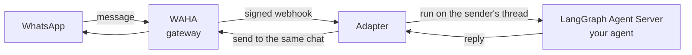

# LangGraph × WhatsApp

**Give your LangGraph agent its own WhatsApp.** Link a WhatsApp account with one QR scan, and people can talk to your agent from the app they already use: by text, voice note or photo. It replies in the same chat and keeps that conversation’s context.


[Website](https://lg-whatsapp.vercel.app) · [How it works](#how-it-works) · [Get started](#get-started) · MIT licensed

## Why it's useful

- **Meet people where they already are.** No extra app to install or account to create. If they have WhatsApp, they can reach your agent.
- **Let them ask however they like.** Type, send a voice note or share a photo. Ask for a picture and the agent sends one back.
- **Conversations that remember.** Each chat has its own history, so follow-up questions can use earlier messages.
- **Start with your agent.** The WhatsApp connection and message routing are built, so you can begin with the instructions and tools in one file.

## Get started

This local starter uses WAHA, an unofficial linked-device gateway, rather than Meta’s official WhatsApp Business Cloud API.

**You'll need** Node.js 24, Docker, a WhatsApp account for the agent (a spare one is best) and a second account to message it from.

> [!TIP]
> No API key yet? You can still see it working. Out of the box, the agent sends sample replies and placeholder media, so you can test the connection and message flow before adding your keys. Sample replies don't understand voice notes or photos.

```bash
git clone https://github.com/ahmad2b/langgraph-whatsapp.git
cd langgraph-whatsapp
npm ci && npm run setup          # install, and create your private .env
docker compose up -d --build     # start the agent, the adapter and WhatsApp
npm run status -- --wait         # wait until all three are ready
npm run whatsapp -- start        # open a WhatsApp session
npm run whatsapp -- qr           # save the pairing QR to .data/pairing.png
```

Open `.data/pairing.png` and scan it from **WhatsApp → Linked devices** on the agent's phone.

**Allow your test account.** The agent only answers senders you list, so nobody can use it by accident. Send it a message from your other account, then find that account's ID in the adapter log:

```bash
docker compose logs adapter | grep "Ignored a message"
```

Copy the ID, for example `15550000001@c.us` or `123456789012345@lid`, into `.env` as `WAHA_ALLOWED_SENDERS=...`, then apply it and message again:

```bash
docker compose up -d adapter
```

**What you should see:** _typing…_ appears in the chat, followed by a reply.

Prefer a browser? Run `npm run web:install && npm run web:dev`, open http://localhost:3004/setup, and click **Start linking**. It shows the QR on the page and walks you through a test reply.

## How it works

Every message takes the same path through three services running in Docker on your machine. Start by customizing the agent; the included adapter handles the WhatsApp connection and message routing.



1. **WhatsApp → WAHA.** Someone messages the agent's number. WAHA is linked to that account like WhatsApp Web, and forwards the message to the adapter as a signed webhook.
2. **WAHA → adapter.** The adapter checks the signature, skips groups, old and duplicate messages, and shows _typing…_. Voice notes are transcribed, and photos are attached to the question.
3. **Adapter → your agent.** The adapter runs your agent on the LangGraph Agent Server, in that person's own conversation thread, so it remembers what was said before.
4. **Back to the same chat.** The adapter takes the reply, and any generated image, and sends it through WAHA to the chat the message came from. The model never chooses who to reply to.

## Make it yours

**Change what the agent does.** Edit the instructions and tools in [`src/agent/index.ts`](src/agent/index.ts). It's a standard LangChain `createAgent`, so you can add tools or replace it with your own graph that keeps a messages state.

**Switch on real answers.** Add your keys to `.env`, then restart the agent and adapter:

```dotenv
AGENT_MODEL_MODE=openai
OPENAI_MODEL=gpt-6-luna
OPENAI_API_KEY=your-openai-key
SPEECH_MODE=cloudflare
IMAGE_MODE=cloudflare
CLOUDFLARE_ACCOUNT_ID=your-account-id
CLOUDFLARE_API_TOKEN=your-workers-ai-token
```

```bash
docker compose up -d agent adapter
```

| Job                                     | Provider                          |
| --------------------------------------- | --------------------------------- |
| Chat, photos and conversation summaries | OpenAI GPT-6 Luna                 |
| English voice notes                     | Cloudflare Whisper Large V3 Turbo |
| Image generation                        | Cloudflare FLUX.2 Klein 4B        |
| WhatsApp connection                     | WAHA, with a linked account       |

The Cloudflare token needs Workers AI Read and Edit permissions. Create it under **Workers AI → Use REST API → Create API Token**. Provider usage is billed to your own accounts.

**Choose who can message it.** `WAHA_ALLOWED_SENDERS` in `.env` is a comma-separated list of exact WhatsApp IDs. It starts empty, so nobody gets a reply until you add someone; the adapter log shows the ID of every sender it ignores. Set it to `*` to answer everyone, but only do that with spending limits on your provider accounts, since every message runs the agent and its tools.

## Reference

<details>
<summary><b>Commands</b></summary>

| Command                                | What it does                                       |
| -------------------------------------- | -------------------------------------------------- |
| `npm run setup`                        | Create your private `.env` (keeps an existing one) |
| `npm run status`                       | Check the agent, adapter and WhatsApp gateway      |
| `npm run whatsapp -- status`           | Check the linked WhatsApp session                  |
| `npm run whatsapp -- resume`           | Restart a stopped session without re-pairing       |
| `npm run whatsapp -- stop`             | Stop the WhatsApp session                          |
| `npm run forget -- '15550000001@c.us'` | Delete one person's conversation memory            |

To forget someone, stop the adapter first, run `forget` with their exact ID, then start the adapter again. This deletes what the agent remembers, not their WhatsApp messages.

**For development:** `npm run check` (formatting and TypeScript), `npm run format`, `npm run agent:dev` and `npm run adapter` (run either outside Docker), and `npm run web:check` for the website.

</details>

<details>
<summary><b>Settings, services and where data lives</b></summary>

**Sample replies.** A new `.env` starts with `AGENT_MODEL_MODE`, `SPEECH_MODE` and `IMAGE_MODE` set to `fixture`: scripted replies, a fixed voice transcript and a placeholder image. Change them as shown in [Make it yours](#make-it-yours) to use real models.

| Service                | Port |
| ---------------------- | ---- |
| LangGraph Agent Server | 2024 |
| WhatsApp adapter       | 3010 |
| WAHA gateway           | 3011 |

All ports listen on your machine only. Conversations live in the `agent-state` Docker volume, and the WhatsApp link lives in `waha-noweb-sessions`, so you don't need to scan again after a restart. Keep both volumes when rebuilding. The local Agent Server needs no database; LangGraph's production Agent Server uses Postgres and Redis instead.

Your `.env`, pairing images and saved state are excluded from Git and from Docker builds.

</details>

<details>
<summary><b>Good to know</b></summary>

- **It runs on an unofficial gateway.** WAHA links like WhatsApp Web; it is not Meta's WhatsApp Business Cloud API.
- **Closed by default.** Only senders listed in `WAHA_ALLOWED_SENDERS` reach the agent.
- **Private chats only.** Groups, the agent's own messages and old events are skipped. Voice notes are answered in text.
- **One run per chat, nothing dropped.** Two runs on one thread fight over the same history, so each chat answers one message at a time. Messages that arrive mid-reply wait their turn, and texts that pile up are answered together, since people split one thought across several texts. Up to four chats run in parallel.
- **Queue and delivery limits.** Up to 10 messages can wait per chat, with 50 waiting overall. The queue and duplicate tracking live in memory, so a restart can lose queued messages. Failed replies are not retried.
- **Saving is slightly delayed.** The local Agent Server delays writes to disk, so a crash can lose the newest messages.
- **Bounded by design.** Provider calls and agent runs have timeouts and bounded outputs. There's no built-in spending cap, so set one with your provider.
- **Keep it private.** For a public service, add authentication, durable delivery and monitoring.

</details>

<details>
<summary><b>Project layout</b></summary>

- `src/agent/`: the agent: instructions, calculator and image tools, and the sample-reply model
- `src/whatsapp/`: webhook checks, message validation, and the WAHA and LangGraph clients
- `src/media/`: voice transcription, media checks, typing and the main message flow (`pipeline.ts`)
- `scripts/`: setup, status, pairing and forgetting a conversation
- `web/`: the website and the local setup page

</details>

## Where to take it next

This is a base to build on. Ideas that fit naturally:

- A `/new` command, so people can start a fresh conversation
- A recap of the old conversation when someone starts over
- Contact profiles that remember names and preferences across conversations
- Human handoff with LangGraph interrupts
- [Deep Agents](https://docs.langchain.com/oss/javascript/deepagents/overview) for longer, multi-step work
- LangGraph's production Agent Server, and Meta's official Cloud API in place of WAHA

More on the [website](https://lg-whatsapp.vercel.app/#extensions).

## Questions or ideas?

Open an issue, or email me at ahmadshaukat_4@outlook.com. I read every email.

## License

MIT. See [LICENSE](LICENSE) and [third-party notices](THIRD_PARTY_NOTICES.md).
